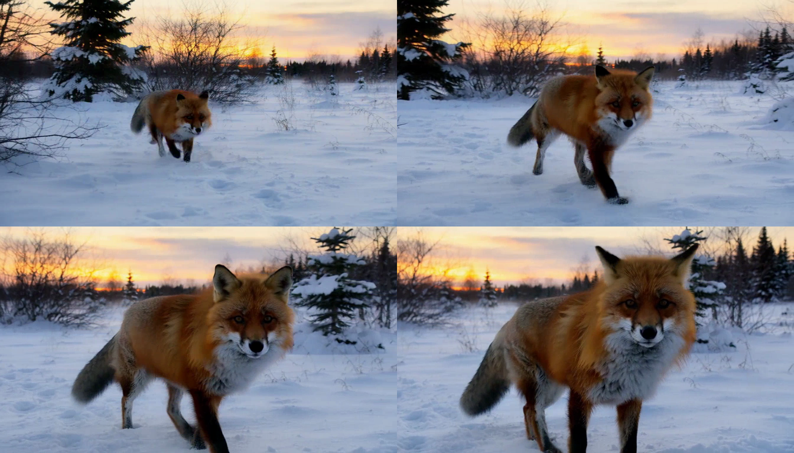

University of Pennsylvania, CIS 5650: GPU Programming and Architecture, Final Project - H3 Megakernel

* Chen Cheng, Ryan Morris, Neel Shejwalkar
* Tested on: NVIDIA RTX PRO 6000 Blackwell Server Edition, 96 GB

### Screenshots



These are four frames of a 5 s clip with audio, generated on one RTX PRO 6000.

### H3 Megakernel

MiniMax-H3 turns a text prompt into video with sound. It has a text encoder, a DiT, a video decoder and an audio decoder. Our goal is to run all four in one CUDA launch and measure what fusion buys at each stage. We expect fusion to help less as kernels get bigger.

### Checkpoint

We use [FastH3 V2 NVFP4 Consumer](https://huggingface.co/FastVideo/FastVideo-FastH3-8-Step-V2-NVFP4-Consumer) at `9d0d0d3` and run it with [FastVideo](https://github.com/hao-ai-lab/FastVideo) at `ce970eb`. It is H3 distilled to 8 steps, with most large linears stored in NVFP4, a 4-bit format with one scale per 16 values.

The text encoder is Qwen3-VL cut to 50 layers. The DiT has 50 blocks with sparse attention on 64-token tiles. The video decoder is a 26-block lightweight VAE with INT8 weights. We generate 1344x768, 5 s clips (124 frames) with 8 forwards and no CFG.

FastVideo offloads models to the host by default. We turn that off, because one launch needs every model on the GPU.

### Milestone 1: DiT MLP

Our first component is the MLP of one DiT block. It expands each token to 28,672 values, splits them in half, multiplies `up` by `silu(gate)`, and projects the result back to 5,376 values. In NVFP4, the input of each GEMM has to be quantized first.

```
up, gate = q(x, sf1) W1
h        = up * silu(gate)
y        = q(h, sf2) W2
```

This table shows the tensors. `m1/weights.py` reads them from the checkpoint by byte range, about 130 MB.

| Tensor | Shape | Notes |
|---|---|---|
| `x`, `y` | `[M, 5376]` BF16 | input and output tokens |
| `w1` | `[28672, 2688]` uint8 | two FP4 values per byte, up rows first, then gate |
| `s1` | `[28672, 336]` uint8 | one FP8 scale per 16 columns, swizzled for the 128x4 layout |
| `w2`, `s2` | `[5376, 7168]`, `[5376, 896]` uint8 | same layout |
| `alpha`, `sf` | FP32, one per linear | weight scale and calibrated activation scale |

We compare a split build, which runs two kernels, with a fused build, which runs one persistent kernel. The fused kernel queues tasks per token group, and FC2 tiles wait on the group's counter before they read `h`. Both share one GEMM tile, so any difference comes from fusion. Neither is written yet, so `split` and `fused_g*` report `not_implemented`.

A kernel passes if its error against FP32 is at most twice the error of the `flashinfer` path on the same input. The FP32 reference uses the checkpoint's FP4 weights and does not round the activations. Kernels that fail are not timed.

### Running

NVFP4 needs Blackwell, so use the RTX PRO 6000 for everything, with small token counts while writing kernels. FlashInfer compiles its kernels the first time, about a minute per container.

```bash
modal run modal_run.py
modal run modal_run.py --args "--tokens 256 1024 --variants flashinfer split"
modal run modal_run.py --ncu "--tokens 4096 --variants flashinfer split"
```

The whole pipeline needs a FastVideo checkout at `ce970eb` with the `cutlass` and `tk` submodules under `fastvideo-kernel/include/`. Use one shape per process, because a second shape fails while compiling its VAE graph on a new thread.

```bash
H3MK_FV_SRC=<checkout> modal run --detach baseline/fastvideo_modal.py::download
H3MK_FV_SRC=<checkout> modal run --detach baseline/fastvideo_modal.py::go --run-id <id> --args "--shapes 1344x768"
```

### Performance Analysis

We measured everything on one RTX PRO 6000 with 97,887 MiB of memory. Memory comes from `nvidia-smi` every 0.5 s. The first request compiles the VAE and takes about 4 minutes, so the times below are later requests, and those stayed within 1% of each other.

This table shows the whole pipeline with every model on the GPU.

| | 1344x768 | 832x480 |
|---:|---:|---:|
| Memory after loading | 58,275 MiB | 58,273 MiB |
| Peak memory | 67,851 MiB | 62,797 MiB |
| Text encoder | 0.09 s | 0.09 s |
| DiT, 8 forwards | 25.9 s | 8.7 s |
| Video decoder | 4.5 s | 1.9 s |
| Audio decoder | 0.05 s | 0.05 s |
| Whole request | 31.0 s | 11.0 s |

From the table, the DiT is 84% of a 1344x768 request and the video decoder is 14%. The first request peaks at 68,385 MiB, which leaves 29,502 MiB free. Our kernels' buffers have to fit in that, and we have not measured them yet.

This table shows the MLP on the `flashinfer` path, which makes the same FlashInfer calls as FastVideo with our own compiled SwiGLU. We ran each size 20 times after 3 warmups, flushed the L2 before each run and kept the middle run. Runs moved by up to 7%.

| Tokens | Time (ms) | TFLOP/s | Error vs FP32 |
|---:|---:|---:|---:|
| 256 | 0.197 | 602 | 13.2% |
| 1,024 | 0.448 | 1,056 | 13.2% |
| 4,096 | 1.738 | 1,090 | 13.2% |
| 14,830 | 6.180 | 1,110 | 13.1% |
| 37,696 | 15.880 | 1,098 | 13.1% |

From the table, the speed stays around 1,100 TFLOP/s from 1,024 tokens up. The error is large because the inputs are random and FP4 rounds them coarsely. Real activations may give a different number, so we will set the bar again with captured activations in Milestone 2.

This table shows each kernel at 37,696 tokens, from one Nsight Compute run without the L2 flush.

| Kernel | Time (ms) | DRAM read (GB) | DRAM write (GB) | L2 (GB) |
|---|---:|---:|---:|---:|
| quantize x | 0.335 | 0.41 | 0.08 | 0.61 |
| FC1 GEMM | 8.644 | 0.24 | 2.13 | 53.32 |
| SwiGLU | 2.123 | 2.16 | 1.03 | 3.24 |
| quantize h | 0.912 | 1.08 | 0.27 | 1.49 |
| FC2 GEMM | 4.330 | 0.35 | 0.36 | 25.98 |

From the table, the two GEMMs take about 80% of the time. FC1 reads only 0.24 GB from DRAM. This is because its 87 MB of weights and scales fit in the 128 MiB L2. SwiGLU and quantizing `h` take about 3 ms and read about 3 GB from DRAM. We think these are the first things the fused build can save, and `group_tokens` decides how much of `h` stays in L2.

### Credits

* [MiniMax-H3](https://huggingface.co/MiniMaxAI/MiniMax-H3) and [FastH3](https://huggingface.co/collections/FastVideo/fastvideo-fasth3) for the model weights
* [FastVideo](https://github.com/hao-ai-lab/FastVideo) and [FlashInfer](https://github.com/flashinfer-ai/flashinfer) for the baseline
* [LynnReal lightweight VAE](https://github.com/LynnReal-AI/LynnReal-Omni) and [Kijai's INT8 weights](https://huggingface.co/Kijai/MiniMax-H3-experimental) for the video decoder
