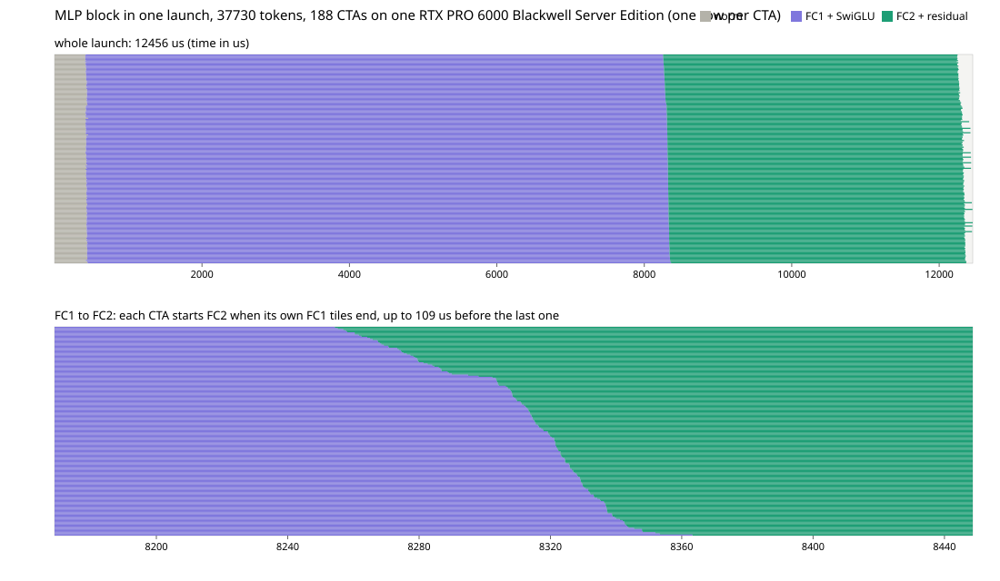

### Milestone 1 (11/11): Baseline and first kernels

We profile H3 on FastVideo, store intermediate outputs for correctness tests, and begin the fused kernels, one person per stage.

| Owner | Task | Status |
|---|---|---|
| All | Time the whole pipeline on one RTX PRO 6000 | Done |
| All | Profile each stage with Nsight ([docs/profiling.md](../profiling.md)) | Done |
| All | Store each stage's inputs, outputs and block 0 tensors | Not started |
| Encoder | GEMM tile and split MLP in `csrc/mlp_split.cu` | Not started |
| DiT | Fused MLP in `csrc/mlp_fused.cu` | Not started |
| Decoder | MLP harness in `m1/` | Done |
| Decoder | DiT MLP block in one launch on FlashInfer's kernels, `m1/fi_mlp.py` | Done |
| Decoder | First INT8 ConvRot linear of the video decoder | Not started |

### DiT MLP

Our first component is the MLP of one DiT block. It expands each token to 28,672 values, splits them in half, multiplies `up` by `silu(gate)`, and projects the result back to 5,376 values. In NVFP4, the input of each GEMM has to be quantized first.

```
up, gate = q(x, sf1) W1
h        = up * silu(gate)
y        = q(h, sf2) W2
```

This table shows the tensors. `m1/weights.py` reads them from the checkpoint by byte range, about 130 MB.

| Tensor | Shape | Notes |
|---|---|---|
| `x`, `y` | `[M, 5376]` BF16 | input and output tokens |
| `w1` | `[28672, 2688]` uint8 | two FP4 values per byte, up rows first, then gate |
| `s1` | `[28672, 336]` uint8 | one FP8 scale per 16 columns, swizzled for the 128x4 layout |
| `w2`, `s2` | `[5376, 7168]`, `[5376, 896]` uint8 | same layout |
| `alpha`, `sf` | FP32, one per linear | weight scale and calibrated activation scale |

We compare a split build, which runs two kernels, with a fused build, which runs one persistent kernel. The fused kernel queues tasks per token group, and FC2 tiles wait on the group's counter before they read `h`. Both share one GEMM tile, so any difference comes from fusion. Neither is written yet, so `split` and `fused_g*` report `not_implemented`.

A kernel passes if its error against FP32 is at most twice the error of the `flashinfer` path on the same input. The FP32 reference uses the checkpoint's FP4 weights and does not round the activations. Kernels that fail are not timed.

### Running

NVFP4 needs Blackwell, so use the RTX PRO 6000 for everything, with small token counts while writing kernels. FlashInfer compiles its kernels the first time, about a minute per container.

```bash
modal run modal_run.py
modal run modal_run.py --args "--tokens 256 1024 --variants flashinfer split"
modal run modal_run.py --ncu "--tokens 4096 --variants flashinfer split"
```

### Results so far

This table shows the MLP on the `flashinfer` path, which makes the same FlashInfer calls as FastVideo with our own compiled SwiGLU. We ran each size 20 times after 3 warmups, flushed the L2 before each run and kept the middle run. Runs moved by up to 7%.

| Tokens | Time (ms) | TFLOP/s | Error vs FP32 |
|---:|---:|---:|---:|
| 256 | 0.197 | 602 | 13.2% |
| 1,024 | 0.448 | 1,056 | 13.2% |
| 4,096 | 1.738 | 1,090 | 13.2% |
| 14,830 | 6.180 | 1,110 | 13.1% |
| 37,696 | 15.880 | 1,098 | 13.1% |

From the table, the speed stays around 1,100 TFLOP/s from 1,024 tokens up. The error is large because the inputs are random and FP4 rounds them coarsely. Real activations may give a different number, so we will set the bar again with the stored tensors.

This table shows each kernel at 37,696 tokens, from one Nsight Compute run without the L2 flush.

| Kernel | Time (ms) | DRAM read (GB) | DRAM write (GB) | L2 (GB) |
|---|---:|---:|---:|---:|
| quantize x | 0.335 | 0.41 | 0.08 | 0.61 |
| FC1 GEMM | 8.644 | 0.24 | 2.13 | 53.32 |
| SwiGLU | 2.123 | 2.16 | 1.03 | 3.24 |
| quantize h | 0.912 | 1.08 | 0.27 | 1.49 |
| FC2 GEMM | 4.330 | 0.35 | 0.36 | 25.98 |

From the table, the two GEMMs take about 80% of the time. FC1 reads only 0.24 GB from DRAM. This is because its 87 MB of weights and scales fit in the 128 MiB L2. SwiGLU and quantizing `h` take about 3 ms and read about 3 GB from DRAM. We think these are the first things the fused build can save, and `group_tokens` decides how much of `h` stays in L2.

### MLP block in one launch

FlashInfer ships a fused H3 MLP for our GPU, `flashinfer.diffusion_ops.minimax_h3_mlp_nvfp4_sm120`. It runs RMSNorm, AdaLN and quantization, then FC1 with SwiGLU and quantization of `y`, then FC2 with the gated residual, as three persistent launches. FastVideo does not use it. `m1/fi_mlp.py` runs the same three kernels as one launch.

At build time, `fuse()` reads FlashInfer's generated source from the installed package, copies the three kernels into device functions and calls them one after another from one persistent kernel, one CTA per SM. FlashInfer's own kernels stay as they are, and none of its code is in our repo. Each CTA runs its share of the norm rows, then its FC1 tiles, then its FC2 tiles:

- The norm phase runs as three groups of 128 threads. After each row, a group adds 1 to a counter for that row's 128-row block.
- Before loading a group of 16 FC1 row tiles, the FC1 producer waits until those counters reach their row counts. After storing each 128 x 128 tile of `y`, FC1 adds 1 to a counter for its 256 rows.
- FC2 already waits on a counter per 256 rows before its TMA loads. It now waits for FC1's 224 tiles instead of the value FlashInfer pre-fills.
- Between FC1 and FC2, each CTA invalidates FC1's mbarriers and sets every warp back to 168 registers, because FC1 and FC2 give their warps opposite roles.

All CTAs are resident and a tile only waits on earlier phases, so the launch cannot deadlock. The math is FlashInfer's, so the output is bitwise equal.

This table shows the block on block 0's weights and random inputs. The two builds took turns in each of 60 rounds with the L2 flushed, and the saving is the median of the paired differences.

| Tokens | FlashInfer, 3 launches (ms) | One launch (ms) | Saving | FC2 starts before the last FC1 ends (us) | Bitwise equal |
|---:|---:|---:|---:|---:|---|
| 256 | 0.272 | 0.276 | -1.2% | 47 | yes |
| 1,024 | 0.398 | 0.399 | -0.2% | 48 | yes |
| 4,096 | 1.410 | 1.380 | +2.1% | 56 | yes |
| 14,830 | 4.936 | 4.884 | +1.1% | 71 | yes |
| 37,730 | 12.542 | 12.439 | +0.8% | 109 | yes |

From the table, one launch saves 1-2% from 4,096 tokens up and costs a few microseconds at 256 and 1,024 tokens. Each CTA moves to FC2 as soon as its own FC1 tiles are done, as the figure shows at 37,730 tokens. The saving is smaller than this overlap suggests, because each CTA's FC1 phase is longer than FlashInfer's FC1 launch. We have not found why: the kernel keeps 168 registers per thread and does not spill.



This table shows the MLP half of every DiT block replaced in FastVideo, one 1344x768, 5 s request per column after a warmup (`baseline/mlp_swap.py`).

| | FastVideo | FlashInfer MLP, 3 launches | One launch |
|---|---:|---:|---:|
| MLP part of the DiT, 400 calls | 6.94 s | 5.17 s | 5.14 s |
| Whole request | 30.84 s | 29.13 s | 29.10 s |

From the table, most of the saving comes from FlashInfer's fusion, and one launch adds 0.04 s. On the first three calls of each request, the one-launch output equals the three-launch output bitwise and its error against FP32 matches FastVideo's. The request times leave out those checks. The videos differ from FastVideo's in composition but not in quality: the 8-step model turns the 2% difference between FlashInfer's and FastVideo's rounding into a different sample, so we judge each block against FP32 as in [contract.md](../contract.md).

FlashInfer is Apache-2.0, and the course asks for approval on Ed before we build on third-party code.

```bash
H3MK_FV_SRC=<checkout> modal run --detach baseline/fastvideo_modal.py::go --run-id <id> --script fi_mlp_check.py
H3MK_FV_SRC=<checkout> modal run --detach baseline/fastvideo_modal.py::go --run-id <id> --script fi_mlp_bench.py --args "--profile 4096 37730" --nsys
H3MK_FV_SRC=<checkout> modal run --detach baseline/fastvideo_modal.py::go --run-id <id> --args "--shapes 1344x768 --arms fastvideo flashinfer_mlp mlp_one_launch"
```

The first command builds the kernel and checks it bitwise at 256, 1,024 and 37,730 tokens. The second writes `fi-mlp-one-launch.json` and an nsys report to the run folder; `python baseline/fi_mlp_bench.py --plot <json>` draws the figures.
