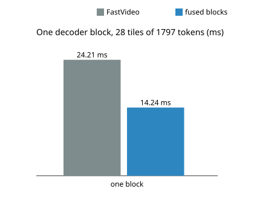
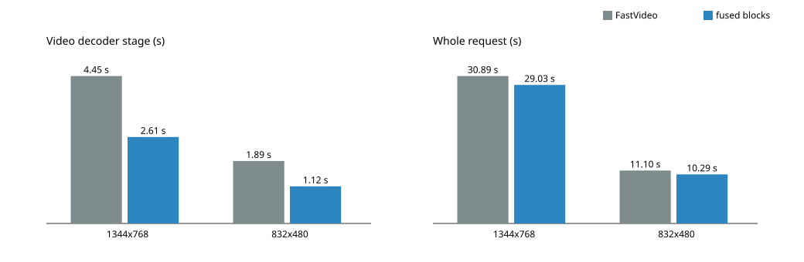

### Milestone 2 (11/18): The rest of each stage, against FastVideo

We keep the approach from [Milestone 1](m1.md). We pick a part of a stage from the profile, run it in fewer kernels, swap it into FastVideo and compare with the baseline. We use FlashInfer's or FastVideo's kernels where they cover the part and write our own where they do not. Ryan and Neel take the text encoder and more of the DiT block, and Chen takes the video and audio decoders.

| Owner | Task | Code | Status |
|---|---|---|---|
| Encoder, DiT | Attention half of the DiT block: QK norm, RoPE, attention and out-proj | `stages/dit/` | |
| Encoder, DiT | Text encoder | `stages/text_encoder/` | |
| Decoder | Video decoder | `stages/video_decoder/` | Blocks fused and checked in FastVideo, [below](#video-decoder) |
| Decoder | Audio decoder | `stages/audio_decoder/` | Not started |
| All | Store each stage's inputs and outputs, moved from Milestone 1 | `h3-megakernel-cache` Volume | |
| All | Chart each swapped part and the whole request against FastVideo, at 832x480 and 1344x768 | `results/` | Video decoder done |

### Where the time goes

These numbers come from the nsys report of one 1344x768, 5 s request ([profiling.md](../profiling.md)). The DiT row is block 25 of step 4, and a request runs 400 blocks.

| Stage | Time | Kernels | Largest parts |
|---|---:|---:|---|
| DiT block | 64.6 ms | 101 | attention 21.7 ms, 7 NVFP4 GEMMs 22.7 ms, FP4 quantize 4.7 ms, QK norm and RoPE 3.1 ms, top-k and sort for the sparse tiles 1.3 ms |
| Video decoder | 4.45 s | 7,250 | 1,092 INT8 GEMMs 1.74 s, 1,274 FP16 GEMMs 0.45 s, attention 0.41 s, row quantize to INT8 0.34 s, Triton norm and SwiGLU kernels about 1.2 s |
| Text encoder | 115 ms | 3,062 | 18 ms of kernels, so the GPU is idle 84% of the time |
| Audio decoder | 56 ms | 2,792 | |

### DiT attention half

FlashInfer 0.7.4rc1 also ships SM120 kernels for this half in `flashinfer.diffusion_ops`: pre-attention, attention, out-proj and gate. FastVideo uses none of them.

1. Check which of them compute what FastVideo computes, including its sparse attention on 64-token tiles.
2. Swap the ones that match into FastVideo, as `baseline/mlp_swap.py` does for the MLP.
3. Run them as one launch, as `stages/dit/fi_mlp.py` does.

The sparse tile selection calls `cudaStreamSynchronize` once per block. It has to move onto the GPU before the whole block can run in one launch.

### Text encoder

The text encoder is the only stage where the gaps between kernels cost time. Its RMSNorm runs as a chain of small eager kernels (pow, mean, add, rsqrt, multiplies and casts), 200 times per request. Fusing these, or running the encoder as one launch, saves at most about 0.1 s per request. It still tests the small-kernel end of our hypothesis, so we chart the gap time removed as well as the total.

### Video decoder

The video decoder is a ViT with 26 transformer blocks. Each block has 32 heads of 64 channels and a SwiGLU feed-forward of 8,192 channels. At 1344x768 each decoder call holds 28 tiles of 1,797 tokens, 50,316 rows in all, and a request makes 7 calls, one per temporal clip.

The checkpoint stores the six linears of each block (q, k, v, out, w1 and w2) in INT8 with one scale per output channel. The weights are rotated offline by a 256x256 Hadamard matrix, a matrix of +1 and -1 that spreads large values across channels, so INT8 loses less. FastVideo runs each linear in four steps: it rotates the input with an fp16 GEMM, quantizes each row to INT8, runs an INT8 GEMM to int32 with cuBLAS and multiplies by the row and channel scales. Inductor fuses the small steps into Triton kernels, but the GEMMs stay library calls, about 40 kernels per block. This table shows where the decoder of one 1344x768 request spends its time, in our baseline nsys report.

| Kind | Kernels | Time |
|---|---:|---:|
| int8 GEMM | 1,092 | 1.74 s |
| norm, residual and dequant | 1,092 | 0.70 s |
| dequant and SwiGLU | 182 | 0.50 s |
| rotation, as an fp16 GEMM | 1,274 | 0.45 s |
| attention | 182 | 0.41 s |
| row quantize | 1,092 | 0.34 s |
| q/k norm and RoPE | 182 | 0.16 s |
| everything else | 2,154 | 0.14 s |
| total, with 15 ms of gaps | 7,250 | 4.43 s |

From the table, most of the time moves bytes. Each INT8 GEMM writes int32 to memory and the next kernel reads it back. For w1 that is 50,316 x 16,384 x 4 bytes, 3.3 GB each way. The rotation's fp16 output also goes to memory before the quantizer reads it. The gaps between kernels are only 0.3% of the decoder, so one launch by itself would save little.

### Video decoder kernels

`stages/video_decoder/kernels.cu` runs each block as eight kernels plus FastVideo's attention:

- `rowquant` does a row's RMSNorm, rotation and INT8 quantization in one pass. The 256x256 Hadamard matrix is the Kronecker product of four 4x4 Hadamard matrices, so the rotation is four small 4-point steps, two inside a thread and two across lanes with shuffles. q, k and v read the same input, so they share one call.
- The INT8 GEMM uses CUTLASS's SM80 INT8 mainloop with the 128x128x64 tile that cuBLAS picks for these shapes, and our own epilogue on the accumulator registers. q, k and v are one GEMM, and its epilogue also does the RMSNorm of each head and RoPE and writes fp16 for the attention. For out and w2 the epilogue adds the gated residual in place. For w1 we interleave the value and gate rows, so one thread holds both halves of a channel and writes the SwiGLU output.

The kernels round like FastVideo's eager code: the norm and the rotation are rounded to fp16, the scale is `fp16(amax / 127)` and the dequant is `(acc x row scale) x channel scale + bias`. The GEMMs use 3 pipeline stages, 48 KiB of shared memory, so two CTAs fit on an SM and one CTA's epilogue runs while the other's mainloop runs.

### Video decoder checks

`baseline/vae_block_check.py` takes blocks 0 and 13 from the checkpoint, feeds them a random input of the 1344x768 tile batch and compares each kernel with FastVideo's code on the same input.

- `rowquant` gives the same INT8 codes as FastVideo except for at most 0.001% of them, which differ by 1. We think this is because the rotation adds in a different order, since the 8,192-channel case has no norm and differs too.
- On the same codes, the v, out, w2 and SwiGLU outputs equal FastVideo's bitwise. q and k differ in 0.004% of the values, by at most 0.004, so the difference comes from the head norm and RoPE.
- The whole block's error against an FP32 reference equals FastVideo's: rel_l2 0.0061 for both on block 0 and 0.0139 for both on block 13.

Inside FastVideo, `baseline/vae_swap.py` checks blocks 0, 1, 13 and 25 the same way on their real inputs from the second clip of a request. All four pass. The DiT is untouched and deterministic, so both arms decode the same latents, and the fused arm's video has a PSNR of 40.4 dB against FastVideo's.

### Video decoder results

For one block, `vae_block_check.py` runs each kernel 20 times with the L2 flushed before each run. For whole requests, each process runs a warmup and then four requests that alternate the two arms (`fastvideo_capacity.py --swap vae`). The first fused request runs the checks and is left out. Between two runs, our block times agreed within 0.3% and FastVideo's compiled block within 2.5%. Repeated request times agreed within 0.5%.

This table shows block 0 on the 1344x768 tile batch. FastVideo's block is compiled with inductor, as in its decoder.

| Our kernel | Time |
|---|---:|
| `rowquant`, norm1 (and again for norm2) | 0.40 ms |
| q, k, v GEMM, q/k norm and RoPE | 1.79 ms |
| attention (FastVideo's; 2.48 ms per call in the fused arm's nsys report) | not timed alone |
| out GEMM and residual | 0.77 ms |
| w1 GEMM and SwiGLU | 4.38 ms |
| `rowquant`, 8,192 channels | 0.99 ms |
| w2 GEMM and residual | 2.21 ms |
| whole block, ours | 14.16 ms |
| whole block, FastVideo | 24.37 ms |



From the table, our block takes 42% less time than FastVideo's. The GEMMs with their epilogues are no slower than cuBLAS's plain GEMMs: cuBLAS alone takes 1.95 ms for the three int32 q, k and v GEMMs and 5.09 ms for w1. So the saving is the kernels and memory traffic that the fused epilogues remove. Block 13 took 14.20 ms against 24.53 ms.

This table shows the video decoder stage and the whole request at both shapes.

| | 1344x768, FastVideo | 1344x768, fused | 832x480, FastVideo | 832x480, fused |
|---|---:|---:|---:|---:|
| Video decoder stage | 4.45, 4.45 s | 2.61 s | 1.88, 1.89 s | 1.12 s |
| Whole request | 30.86, 30.89 s | 29.03 s | 11.04, 11.10 s | 10.29 s |
| Video PSNR against FastVideo | | 40.4 dB | | 41.0 dB |



From the table, the decoder takes 41% less time at both shapes, which saves 1.84 s and 0.77 s of the request. The nsys report of the 1344x768 request (`baseline/vae_kernels.py`) shows where it went. The decoder ran 2,501 kernels instead of 7,250. Our INT8 GEMMs took 1.74 s with their epilogues, as long as cuBLAS's GEMMs that only write int32. The norms, rotations, quantizers, dequants, SwiGLU, q/k norm and RoPE took 2.22 s in FastVideo and 0.36 s in `rowquant`. The attention took 37 ms longer, 452 ms against 414 ms. We pass it q, k and v in token-major layout and have not checked whether that layout is the cause.

The checks keep an fp32 reference in PyTorch's cache, so we measured memory in a separate 1344x768 run that skips the checks and releases the cache before each request (`--empty-cache --no-checks`, `results/video-decoder-memory-1344x768.json`). FastVideo peaked at 72,633 and 72,647 MiB and the fused blocks at 69,857 and 69,873 MiB, 2.8 GB less, because the int32 and fp16 intermediates are gone. Both arms hold our 1.4 GB repacked copy of the decoder weights, so the 2.8 GB is activation memory. These peaks are above the 67,851 MiB of the baseline run, which kept the cache between requests.

### Running the video decoder

The kernels build on first use with `torch.utils.cpp_extension` against the CUTLASS headers in the FastVideo checkout (`fastvideo-kernel/include/cutlass`), and the build is kept on the Volume.

```bash
H3MK_FV_SRC=<checkout> modal run --detach baseline/fastvideo_modal.py::go --run-id <id> --script vae_block_check.py
H3MK_FV_SRC=<checkout> modal run --detach baseline/fastvideo_modal.py::go --run-id <id> --args "--shapes 1344x768 --swap vae --arms fused fastvideo fused fastvideo"
python baseline/vae_kernels.py <request.sqlite>
python baseline/vae_plot.py --requests results/video-decoder-1344x768.json results/video-decoder-832x480.json --block results/video-decoder-block-check.json
```

The first command checks and times blocks 0 and 13 and writes `vae_block_check.json`, which we keep as `results/video-decoder-block-check.json`. The second runs the requests and writes `summary.json`, which we keep as `results/video-decoder-<shape>.json`. With `--nsys --args "... --profile-rep 1"` it also writes the nsys report that the third command reads. The last command draws the figures.

The audio decoder is next. It takes 56 ms of the request, and the GPU is idle for 46% of it, so it is the one part of H3 where launch gaps matter.

### Checks

Each swap gets the same checks as in Milestone 1. When the math is the same, the output must equal the library path bitwise. Its error against FP32 must be at most twice FastVideo's (`harness/check.py`). We compare videos by PSNR only when the DiT is untouched, because the 8-step model turns small rounding differences in the DiT into a different sample.

### Done when

Each swapped part passes its checks. Each stage has a chart of FastVideo against our version, for the part and for the whole request, at 832x480 and 1344x768.
